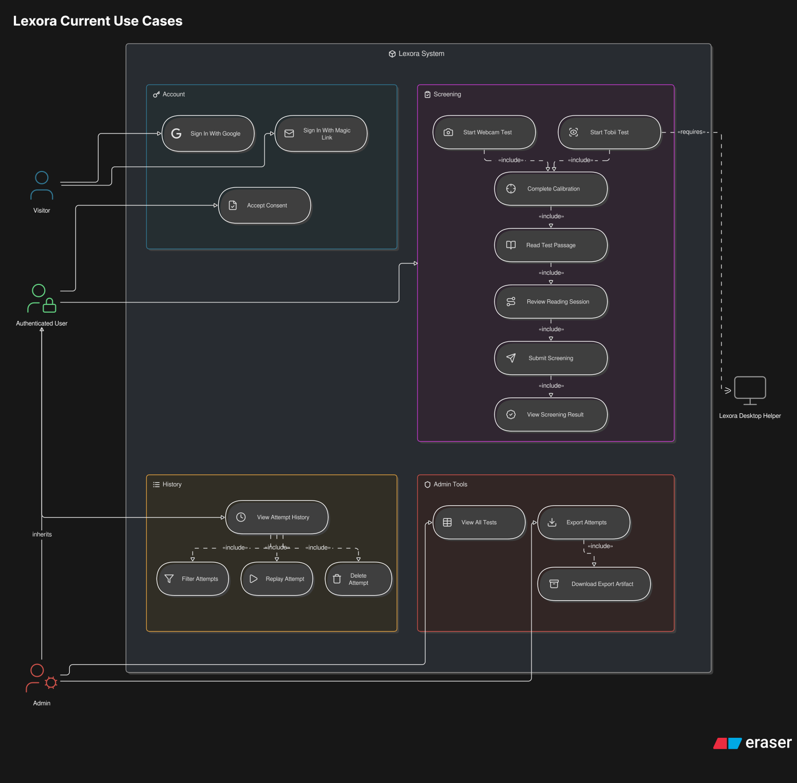
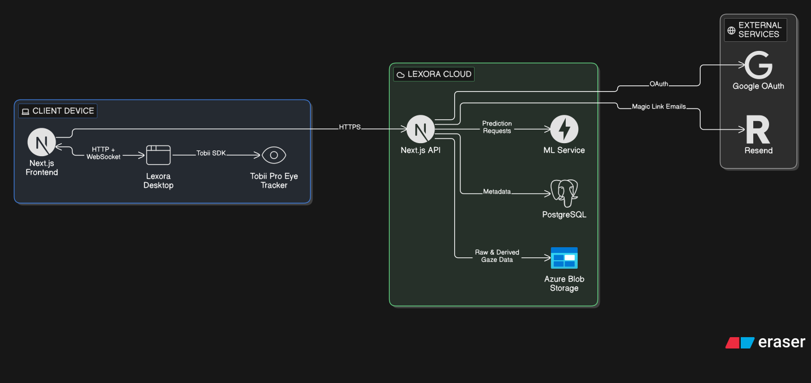
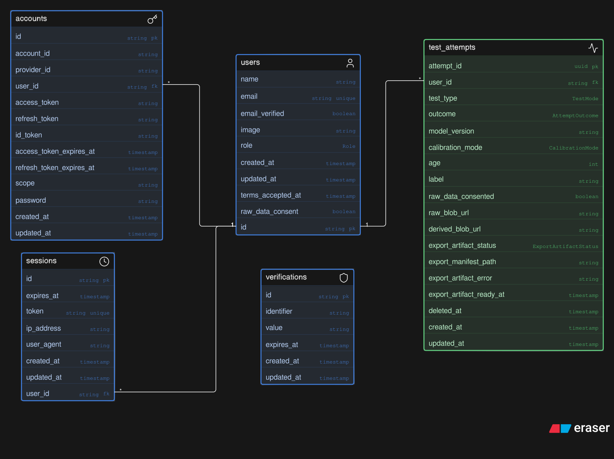

# Lexora Diagrams

These diagrams are the visual index for Lexora. They are meant to help a new reader answer three questions quickly:

- What can the product do?
- How do the web, ML, storage, and device pieces talk to each other?
- Where does gaze data move from capture to prediction?

The rendered diagrams are SVG exports from Eraser. The editable sources live under `source/` and should be committed with any SVG change.

## Read Order

1. Start with [use cases](lexora-use-cases.svg) to understand the product surface.
2. Read [system architecture](architecture/01-system-architecture.svg) for the whole system boundary.
3. Use the focused architecture diagrams when reviewing a specific layer.
4. Use the pipeline diagrams when working on calibration, gaze capture, or prediction logic.
5. Use the [ERD](lexora-erd.svg) when changing persistence.

## Product Surface

The use-case diagram shows the user-facing flows: webcam screening, Tobii screening, account/history access, admin review, and export paths.

  

## Architecture Views

The architecture is intentionally split. One giant diagram became hard to read, so each view has a clear job.

| View | Use It For | Rendered | Source |
| --- | --- | --- | --- |
| System architecture | First-pass explanation of the client, cloud, ML, storage, and external-service boundaries | [SVG](architecture/01-system-architecture.svg) | [Eraser](source/architecture/01-system-architecture.eraserdiagram) |
| Client and device architecture | How the browser, webcam flow, Tobii desktop helper, and eye tracker interact | [SVG](architecture/02-client-device-architecture.svg) | [Eraser](source/architecture/02-client-device-architecture.eraserdiagram) |
| Backend architecture | How Next.js API routes, auth, prediction calls, attempt storage, and exports are organized | [SVG](architecture/03-backend-architecture.svg) | [Eraser](source/architecture/03-backend-architecture.eraserdiagram) |
| ML service architecture | How request validation, feature processors, model loading, and inference are separated | [SVG](architecture/04-ml-service-architecture.svg) | [Eraser](source/architecture/04-ml-service-architecture.eraserdiagram) |
| Deployment and CI/CD | How GitHub Actions, Vercel, GHCR, Azure Container Apps, and desktop releases fit together | [SVG](architecture/05-deployment-cicd-architecture.svg) | [Eraser](source/architecture/05-deployment-cicd-architecture.eraserdiagram) |

### System Architecture

  

## Data And Prediction Pipelines

These diagrams explain runtime behavior. They are the best place to start before changing calibration math, gaze sample collection, feature processing, or ML request handling.

| Pipeline | What It Explains | Rendered | Source |
| --- | --- | --- | --- |
| Calibration | Screen/device checks, target collection, webcam model fitting, Tobii quality analysis, and validation | [SVG](pipelines/calibration-pipeline.svg) | [Eraser](source/pipelines/calibration-pipeline.eraserdiagram) |
| Webcam gaze acquisition | MediaPipe landmarks, feature extraction, calibrated screen mapping, smoothing, and test submission | [SVG](pipelines/webcam-gaze-acquisition-pipeline.svg) | [Eraser](source/pipelines/webcam-gaze-acquisition-pipeline.eraserdiagram) |
| Tobii gaze acquisition | Local Tobii SDK bridge, status API, WebSocket gaze stream, and reading-session buffers | [SVG](pipelines/tobii-gaze-acquisition-pipeline.svg) | [Eraser](source/pipelines/tobii-gaze-acquisition-pipeline.eraserdiagram) |
| ML prediction | Request validation, eye-tracker and webcam feature pipelines, scaler/model artifacts, and risk response | [SVG](pipelines/ml-prediction-pipeline.svg) | [Eraser](source/pipelines/ml-prediction-pipeline.eraserdiagram) |

## Persistence

The ERD describes the relational metadata model. Raw and derived gaze artifacts are stored separately in Azure Blob Storage or Azurite, so the ERD does not try to model every sample payload as relational rows.

  

Source: [source/schema/lexora-erd.eraserdiagram](source/schema/lexora-erd.eraserdiagram)

## Update Workflow

1. Edit the matching file under `docs/diagrams/source/`.
2. Render the updated SVG in Eraser.
3. Replace the SVG in `docs/diagrams/`.
4. Open the SVG locally or in GitHub preview and check labels, direction, and readability.
5. Commit the source and SVG together.

## Review Checklist

- The diagram reflects current code, not old plans.
- The title says what view the reader is looking at.
- Arrows show real data/control flow.
- A reader can understand the diagram without knowing the graduation-project history.
- Any changed architecture diagram is also reflected in the root README or service README when needed.
